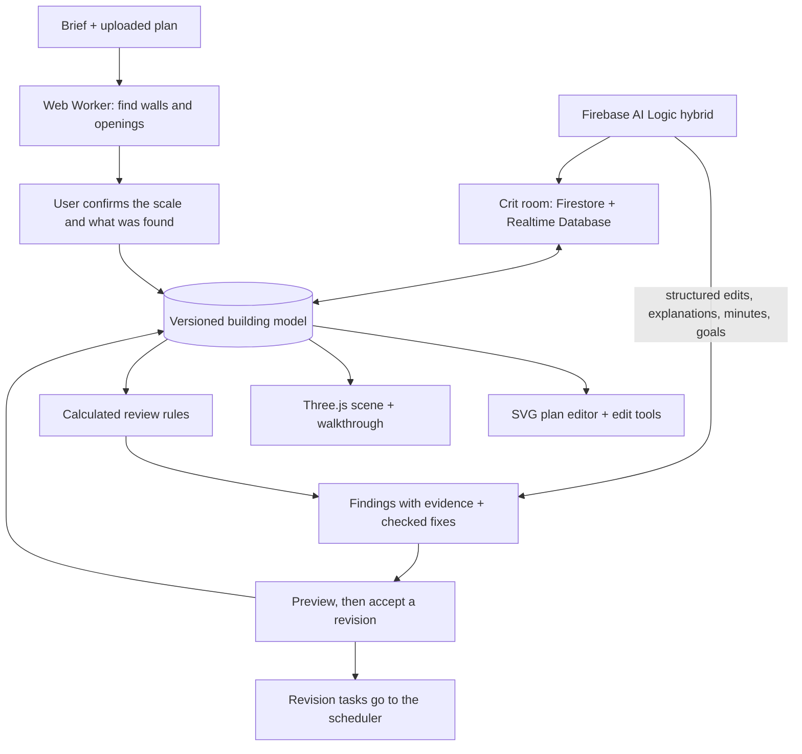

# ArchiMind

ArchiMind turns floor plans into 3D models that architecture students, tutors and clients can review and walk through together.

**Live app:** https://archimind-studio.web.app (free; sign in with Google)

Upload a floor plan, or draw one, and edit it in 2D and 3D. Walk through the building with your tutor, discuss it in a crit room where every comment is pinned to the model, and turn the feedback into revisions and scheduled tasks.

ArchiMind was built for **#BuildHybridAI 2026** with **Firebase AI Logic hybrid inference**: Gemini Nano runs in Chrome on your own computer when it can, and Gemini in the cloud handles the rest. It also uses App Check, Authentication, Firestore, Realtime Database, Remote Config, Analytics and Hosting.

---

## Why ArchiMind

Architecture is taught through crits, where tutors and classmates review a design around its drawings, and architects present to clients in much the same way. The comments usually end up in chat apps or notebooks, away from the drawings they refer to, and decisions are easily lost. ArchiMind keeps the model, the comments and the follow-up work in one place.

- **Students** turn a floor plan into a 3D model, check it against their brief, and get a task in their schedule for each crit comment.
- **Tutors** walk through the student's building with them, pin comments to a particular wall or door, and get the minutes of the crit written for them.
- **Clients** can read every comment in plain language, and their feedback, such as "the kitchen feels cramped", becomes a goal that can be measured on the plan.
- **Privacy:** short AI tasks run on your own computer with Gemini Nano, so your work and your conversations stay on the device. Larger tasks, such as a full design review, go to the cloud. In Private mode, nothing is sent to the cloud.

---

## Highlights

| | |
|---|---|
| **Crit room** | A message can carry the selected elements, a camera view and a snapshot. The presenter shares their view and everyone else follows it live. Anyone can mark up the plan with pins, areas, arrows, notes and suggested walls, doors or windows, and the owner can preview the suggestions as an edit before accepting them. |
| **Plain-language feedback** | A client might say "the kitchen feels cramped" where an architect would say "increase R6 by 15%". ArchiMind turns comments like these into goals linked to particular rooms and walls, and rewrites studio terms in plain language, on the device when possible. |
| **Measured findings** | Room areas, door clashes, privacy, a daylight estimate, reachability and door widths are calculated from the geometry, not guessed by AI. AI feedback, such as rubric comments and the design rationale, is labelled as opinion. Findings are checked again after every edit and close once they are fixed. |
| **Safe AI edits** | The AI can only return structured edits, such as `moveWall` or `relocateOpening`. The geometry engine checks each one, you compare the plan before and after, and accepting the change creates a revision and tasks for the drawings it affects. The app never runs code written by AI. |
| **Walking through together** | Everyone in the crit appears in the model as a person, moving in real time, and raises a hand to open a door. |

---

## Features

- **Plan import:** PNG, JPEG, SVG or PDF. A Web Worker finds the walls, whether drawn solid, as two lines, filled grey or hatched; the doors (from their swing arcs), sliding doors, open passages, windows and pillars; and the scale, from the dimensions written on the drawing. It ignores furniture drawn in lighter lines than the walls. Phone photos and scans are straightened and evened out first, so pen and pencil sketches can be read too. **Firebase AI Logic** then reads the image to name the rooms and to add what the pixel check missed: doors, windows, porches, decks and furniture.
- **Checking the import:** no tool reads every drawing perfectly, so the import shows you everything it found. Click anything to change its type (door, sliding door, window, open passage; outside or inside wall) or to remove it, draw a missing wall, or click a wall to add a door or window. Everything stays editable in the studio afterwards. If the plan came in at the wrong size, select any wall and type its real length, and the whole plan is rescaled.
- **Drawing a plan:** start with an empty plan and draw it wall by wall: click each corner, and the walls join as you go. C closes the shape, U removes the last wall, and Esc finishes. The first outline becomes the outside walls; walls started from another wall become partitions.
- **2D plan:** shown as a construction drawing (black walls, white rooms, dimension lines) or in colour. It has walls, pillars, handrails, hinged, double and sliding doors, open passages, windows, furniture, a measuring tape, your own dimensions and a height for each wall. Wall corners are mitred in the plan and in 3D.
- **Doors, porches, stairs and pillars:** hinged, double, sliding, pocket and folding doors, and open passages; covered porches, verandas, wrap-around and screened porches, porticos, open decks and patios, each with a suitable edge, roof and floor; straight, L-shaped, U-shaped and spiral stairs; and square, round, classical, brick, timber and steel pillars.
- **Drafting tools:** a command line with the short command names used in drafting programs (WA, E, CO, M, RO, MI, O, EX, F, J, SL, DIM, DI, U, Z), snapping (OSNAP, GRID, ORTHO and SNAP on F3, F7, F8 and F9), window and crossing selection, typed wall lengths, copy and paste, split, offset, extend, corner and join. Drag to pan and scroll to zoom; phones and tablets work by touch.
- **3D model:** built with Three.js and React Three Fiber, with real openings in the walls, materials, glass, sliding doors, porches, shadows, the sun at any time of day, section cuts, GLB export and screenshots. A porch set into the house sits under the main roof; one that sticks out gets its own lean-to roof.
- **Roofs:** flat, mono-pitch, gable or hip, or one suggested by AI. Gable and hip roofs are built from the building's footprint, the way BIM tools do it: one outline around every wing, a roof plane rising from each eave at the chosen pitch, and gable ends on edges that don't slope. L, T and U-shaped buildings get one roof with proper hips and valleys. The eaves sit on the outer face of the walls, and small steps caused by drawing errors are smoothed out first.
- **Walkthrough:** see through your own eyes, from just behind yourself, or from above. Drag to look around and use WASD, or click the floor, to walk. Walls, furniture and closed doors block your way. Other people in the crit appear as one of 14 realistic figures.
- **Design review:** calculated findings shown on the plan with their evidence and suggested fixes, and an AI design review with provisional rubric scores (the lecturer still gives the grade).
- **Crit room:** a thread for each element, who is online, following the presenter, mark-up tools, a plain-language view, feedback turned into design goals, edit proposals, editing and deleting your own messages, and **AI minutes** whose actions go straight into the schedule.
- **Revisions and schedule:** each accepted change becomes a revision that records the edits, the findings it fixed and the tasks it created, with written details. The scheduler works out dates from the hours you have each day and draws a Gantt chart.
- **Projects and people:** a projects page to open, close and delete projects, invite links with three access levels (crit only, mark-up or full), resolving crit feedback (project owner only), removing members and deleting your account.

---

## How ArchiMind uses Firebase AI Logic

All generative AI goes through the `firebase/ai` SDK in [`src/ai/hybrid.ts`](src/ai/hybrid.ts) (`getAI`, `getGenerativeModel`, `generateContent`, `generateContentStream`, `InferenceMode`). Each AI feature is a single request with its own JSON schema, which is used both as Gemini Nano's `responseConstraint` and as the cloud model's response schema.

| Request type | What it does | Default routing |
|---|---|---|
| `brief.summarize` | Summarises the brief | `PREFER_ON_DEVICE` |
| `element.explain` | Explains the selected space | `PREFER_ON_DEVICE` |
| `edit.propose` | Turns a request into a structured plan edit | `PREFER_ON_DEVICE` |
| `thread.minutes` | Writes crit minutes, decisions and actions | `PREFER_ON_DEVICE` |
| `message.translate` | Rewrites a message in plain language | `PREFER_ON_DEVICE` |
| `message.intent` | Turns feedback into measurable design goals | `PREFER_ON_DEVICE` |
| `rationale.draft` | Drafts the design rationale, streamed as it is written | `PREFER_ON_DEVICE` |
| `roof.suggest` | Suggests a roof for the brief | `PREFER_ON_DEVICE` |
| `review.interpretive` | Reviews the design against the rubric | `ONLY_IN_CLOUD` |
| `plan.labels` | Reads the room names on a drawing (image input) | `ONLY_IN_CLOUD` |
| `plan.read` | Reads an uploaded plan alongside the pixel check: the overall dimensions as written (which set the scale), whether each opening the check found is a hinged, double or sliding door, a window or an open passage, anything the check missed, porches, and the furniture. It is given the check's results as data and a guide to drafting symbols (image input) | `ONLY_IN_CLOUD` |
| `plan.symbols` | A closer look: every opening the pixel check found, and every piece of furniture found as a closed shape, is cut out, numbered and boxed in red on one sheet, under a legend of standard plan symbols drawn by the app ("set-of-mark" prompting). The model names each tile from the legend and, for furniture, which way its back faces. It never overrules a sliding door found in the pixels, a clear swing arc or clear glazing, and positions and sizes come from the drawing, not the model (image input) | `ONLY_IN_CLOUD` |

- **Three modes** on the AI Logic page: *Balanced* (the routing above), *Private* (`ONLY_ON_DEVICE` for everything: if Gemini Nano isn't available, nothing is sent) and *Cloud* (`ONLY_IN_CLOUD`).
- **Device first, cloud as backup:** in Balanced mode Gemini Nano gets a short head start. If it is slow or unavailable, a cloud request runs alongside it and the first valid answer is used. A computer that keeps timing out is remembered for a while, so people aren't kept waiting.
- **Visible:** every answer shows where it ran (`on_device` or `in_cloud`), and the AI Logic page lists every request with its response time, validation result and token count.
- **Validated:** answers are checked against their schema and against the building model. Unknown element IDs are dropped, and edits must pass the geometry checks. An on-device answer that fails is retried in the cloud, and the log records it.
- **Busy or over quota:** if the main cloud model is overloaded, a second model takes over. When a model's quota runs out, the app stops sending it requests until the quota resets, instead of failing one request after another.
- **Setup check:** shows the Chrome version and Prompt API status, and downloads the on-device model in one click, with progress.
- **App Check:** reCAPTCHA Enterprise protects every AI request (with a debug token for local development).
- **Remote Config:** `cloud_model`, `cloud_model_fallback`, `enable_cloud_review`, `on_device_first`, `limited_use_tokens`, `max_plan_px` and an announcement banner that can be changed at any time.

Without a Firebase config the app runs in **demo mode**: everything still works, AI requests are answered by built-in rules labelled *Heuristic*, and the crit room syncs between browser tabs.

### Other Firebase products

| Product | What ArchiMind uses it for |
|---|---|
| **Authentication** | Google sign-in on the live site; anonymous guests in local development, who can link to Google later and keep their work |
| **Firestore** | Real-time project sync with an offline cache, revision snapshots, crit messages, who is online, camera following, invite links checked by security rules, and AI usage records |
| **Realtime Database** | Walking positions, about 10 times a second, in a room only members can read; each entry is removed when its person leaves |
| **Remote Config** | Model choice, feature switches and limits, applied to open sessions straight away |
| **Analytics / Performance** | Product events, and timings for each AI request type and the plan-reading worker |
| **Hosting** | Serves the app |
| **Cloud Storage** (optional) | Source drawings, crit snapshots and GLB exports, if a Storage bucket exists (this needs the Blaze plan); the app works without it |

---

## Run it

Requirements: Node.js 20.19+ or 22.12+, and desktop Chrome for on-device AI.

```bash
npm install
npm run dev        # http://localhost:5173 (demo mode until you add a Firebase config)
npm test           # geometry, edits, edit tools, roofs, review rules, scheduler, plan reading
npm run build
```

### Connect your own Firebase project

1. Create a Firebase project and add a **Web app**. Copy its config into `.env.local` (see [`.env.example`](.env.example)).
2. **AI Logic:** in the console, open *AI Logic* and click *Get started* with the **Gemini Developer API**.
3. **App Check:** register the web app with **reCAPTCHA Enterprise** and put the site key in `VITE_RECAPTCHA_ENTERPRISE_SITE_KEY`. For local development, set `VITE_APPCHECK_DEBUG_TOKEN=true`, copy the token printed in the browser console, and add it under *App Check > Manage debug tokens*. Keep tokens out of git.
4. **Authentication:** enable **Google** (and **Anonymous** if you want guest mode in development). Add your hosting domain under *Authorized domains*.
5. **Firestore:** create a database.
6. **Realtime Database:** create the default database (used for walking together). If its URL isn't `https://<project-id>-default-rtdb.firebaseio.com`, set `VITE_FIREBASE_DATABASE_URL`.
7. **Rules and config:** `firebase deploy --only firestore,database,remoteconfig`.
8. **Hosting:** `npm run build && firebase deploy --only hosting`.

Optional: set `VITE_FIREBASE_MEASUREMENT_ID` for Analytics. For file uploads, create a Storage bucket (Blaze plan) and run `firebase deploy --only storage`.

### Turn on Gemini Nano in Chrome

In desktop Chrome 139 or later, enable `chrome://flags/#prompt-api-for-gemini-nano-multimodal-input`, restart Chrome, then open **AI Logic > Setup check > Download on-device model**. The download has to start from a click, because Chrome's Prompt API requires one. Without Gemini Nano, Balanced mode uses the cloud.

---

## Architecture



```
src/
  model/      types, geometry, rooms, structured edits, validation, wall shapes, edit tools, roofs
  detect/     plan reader (worker), photo straightening, PDF/SVG/image loading, text extraction
  review/     calculated review rules, rubric, tracking findings across revisions
  schedule/   scheduler and task details
  ai/         Firebase AI Logic hybrid layer, request types, schemas, fallbacks, activity log
  collab/     crit room, who is online, camera following, walking together
  firebase/   app, App Check, Auth, Firestore, Remote Config, project sync, account deletion
  studio/     Plan2D (SVG editor), Viewer3D (React Three Fiber), walkthrough, people, command line, inspector
  pages/      Overview, Brief, Import, Studio, Review, Crit, Schedule, Revisions, AI Logic
```

---

## Limitations

- The plan reader expects square corners. It handles exported plans with solid or hatched walls, scans, and phone photos of pen or pencil sketches. Curved walls, very rough sketches, and open areas drawn with single lines (such as a porch) still need tidying in the studio.
- Daylight is estimated from the ratio of glazing to floor area; it is not a simulation. Findings are design feedback, not structural approval or building-code compliance.
- There is no IFC or other BIM file exchange yet, and no structural, cost or environmental analysis.
- On-device AI needs desktop Chrome with Gemini Nano; other browsers use the cloud.

---

## Roadmap

- [ ] Buildings with more than one floor
- [ ] Balconies
- [ ] Industrial buildings
- [ ] A first layout generated from the brief
- [ ] Profile photos in the walkthrough

---

## License

[Apache License 2.0](LICENSE)

### Trademarks and command names

The plan's command line uses short command names and function keys that are common to many drafting programs (for example L, E, CO, OFFSET, and F8 for ortho). ArchiMind's code is its own: it does not use, copy or connect to any other company's software, and it is not affiliated with or endorsed by any software company. Product names belong to their owners.

### Third-party assets

The walkthrough people (bodies, textures, and walking and standing animations in `public/people/`) come from the [Microsoft Rocketbox avatar library](https://github.com/microsoft/Microsoft-Rocketbox), © 2020 Microsoft, released under the MIT License, which allows commercial use. The textures were resized and converted to WebP. The licence is included in [`public/people/LICENSE-Rocketbox.txt`](public/people/LICENSE-Rocketbox.txt).
